# Kubernetes deployment exercises

Run each command from the folder named for its exercise. The YAML files contain the full resource definitions; this document explains the important settings and the fields removed to simplify them.

## 1. Nginx

Folder: `yml` — [`nginx-deploy.yml`](nginx-deploy.yml), [`nginx-service.yml`](nginx-service.yml)

The Deployment runs three Nginx pods. The Service exposes port 80 through NodePort. The fixed `nodePort` and `targetPort` were removed: Kubernetes assigns a NodePort, and targetPort defaults to the Service port.

```powershell
kubectl apply -f nginx-deploy.yml
kubectl apply -f nginx-service.yml
kubectl get service nginx-svc
```

**Verified:** Deployment ready at 3/3; the Service currently has NodePort 30001.

## 2. TTT app only

Folder: [`local-ttt-app-deploy`](local-ttt-app-deploy) — [`ttt-deploy.yml`](local-ttt-app-deploy/ttt-deploy.yml), [`ttt-service.yml`](local-ttt-app-deploy/ttt-service.yml)

The app Deployment runs three replicas of `albertina1310/tech610-tttapp:1.2.0`. The NodePort Service uses port 3000. Kubernetes assigns the NodePort automatically, so use `kubectl get service ttt-service` to find the current outside port.

`containerPort` was removed because it only documents a container port; it does not publish the port. `targetPort` was removed because it defaults to the Service port (3000). Default namespace and resource metadata labels were also omitted; the pod labels and matching selectors stay because they connect the Deployment and Service to the app pods.

```powershell
kubectl apply -f ttt-deploy.yml
kubectl apply -f ttt-service.yml
kubectl get service ttt-service
```

**Verified:** Deployment ready at 3/3; the current NodePort is 31770.

## 3. TTT app with MongoDB, without persistent storage

Folder: [`ttt-mongo`](ttt-mongo) — [`ttt-deploy.yml`](ttt-mongo/ttt-deploy.yml), [`ttt-service.yml`](ttt-mongo/ttt-service.yml)

The app runs three replicas and MongoDB runs one. The app's `MONGODB_URI` points to `mongodb://ttt-mongo:27017/posts`; `ttt-mongo` is the database Service name. The app Service is NodePort. MongoDB's Service omits `type` because ClusterIP is the default, so the database remains internal.

The container port declarations and Service targetPorts were removed; the Service ports (3000 and 27017) are sufficient because each target uses that same port. The NodePort is assigned automatically.

```powershell
kubectl apply -f ttt-deploy.yml
kubectl apply -f ttt-service.yml
kubectl get service ttt-service ttt-mongo
```

**Verified:** TTT ready at 3/3 and MongoDB at 1/1. The app Service received NodePort 31770; the MongoDB Service remained ClusterIP.

## 4. TTT app with MongoDB persistence (PV and PVC)

Folder: [`pv`](pv) — [`ttt-deploy.yml`](pv/ttt-deploy.yml), [`ttt-service.yml`](pv/ttt-service.yml)

```mermaid
flowchart LR
  Browser[Browser] -->|NodePort assigned by Kubernetes| AppService[ttt-service]
  AppService -->|port 3000| App[TTT app Deployment\n3 replicas]
  App -->|MONGODB_URI: mongodb://ttt-mongo:27017/posts| MongoService[ttt-mongo Service\nClusterIP]
  MongoService --> Mongo[MongoDB Deployment\n1 replica]
  Mongo -->|mountPath /data/db| PVC[ttt-mongo-pvc\n1Gi, ReadWriteOnce]
  PVC -->|bound to| PV[ttt-mongo-pv\n1Gi hostPath]
```



The YAML defines a 1Gi static PV, a PVC, three app replicas, and one MongoDB replica. MongoDB mounts the claim at `/data/db`, where it stores database files. The PVC matches the PV through `storageClassName: manual`, access mode, and capacity; Kubernetes bound it without an explicit `volumeName`. The default Filesystem volume mode is implicit.

The hostPath is `/var/lib/ttt-mongo-pv`. `hostPath.type` was removed, so this directory must already exist on the Docker Desktop node. The PV reported a `Retain` reclaim policy without that field in the YAML. The 1Gi value is the PV/PVC capacity declaration; hostPath does not enforce a disk quota.

```powershell
kubectl apply -f ttt-deploy.yml
kubectl apply -f ttt-service.yml
kubectl get pv
kubectl get pvc
kubectl get service ttt-service
```

To verify data survives a MongoDB pod restart:

```powershell
kubectl delete pod -l app=ttt-mongo
kubectl get pods -l app=ttt-mongo
```

**Verified:** app ready at 3/3, MongoDB ready at 1/1, PV and PVC `Bound`, and NodePort 31770. After deleting and recreating the MongoDB pod, the scoreboard still showed `TST 100` at `http://localhost:31770`.


## Cleanup after the PV exercise

From the `pv` folder, remove the Services, Deployments, PVC, and PV object:

```powershell
kubectl delete -f ttt-service.yml
kubectl delete deployment ttt-deployment ttt-mongo
kubectl delete pvc ttt-mongo-pvc
kubectl delete pv ttt-mongo-pv
```

The PV reported `Retain` in this cluster. Deleting the Kubernetes PV object does not erase the hostPath files under `/var/lib/ttt-mongo-pv`.
