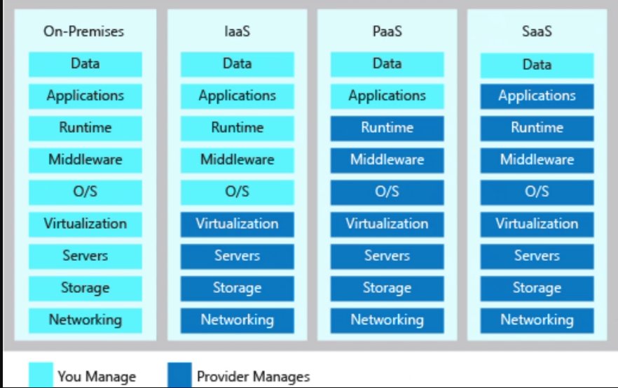

# What Is Cloud Computing?

**Answer:the delivery of computing services—including storage, servers, databases, and software—over the internet instead of using your own computer's hard drive or a local physical server.**

## On-Premises vs Cloud

### What is considered on-premises infrastructure?

**Answer:all the computer hardware and software that a company owns, runs, and keeps physically inside its own office building or local data center. Instead of renting space on remote cloud services like Google Cloud or Amazon Web Services, the business manages everything itself.**

### What is considered cloud infrastructure?

**Answer:Cloud infrastructure refers to the physical and virtual building blocks—such as servers, data storage, networking equipment, and virtualization software—rented from a provider over the internet so you do not need to buy or run them yourself.**

### How do they differ?

| Feature | ☁️ Cloud Infrastructure | 🏢 On-Premises Infrastructure |
|---|---|---|
| **Location** | Hosted in the provider’s data centres. | Hosted in your organisation’s offices or data centres. |
| **Ownership** | You pay to use the provider’s computing resources. | Your organisation owns or leases the hardware. |
| **Upfront Cost** | Usually low, with usage-based or subscription pricing. | Usually high due to hardware purchases and installation. |
| **Maintenance** | The provider maintains physical hardware; your other responsibilities depend on the service type. | Your IT team or contractors maintain the infrastructure. |
| **Scaling Up** | Resources can usually be added quickly, subject to availability and quotas. | Expansion may require purchasing and installing more hardware. |
| **Control** | You control your resources within the service’s limits; the provider controls physical hardware. | You have greater control over hardware and its configuration. |
| **Internet Dependency** | Usually accessed through the internet or a dedicated private connection. | Local services can operate without internet access, depending on their requirements. |

## Cloud Deployment Models

### What are the four main cloud deployment models?

**Answer:
1. Public Cloud (The Public Bus):A giant company like Google or Amazon owns the system, and you rent space on it over the internet.
2. Private Cloud (The Personal Car):The computer system is built exclusively for one company. No outsiders are allowed
3. Hybrid Cloud (The Train + Taxi combo):You connect a public cloud and a private cloud together.
4. Community Cloud (The Co-op Van):Several organizations with the exact same goals (like four friendly hospitals or police stations) share one private system to save money.**

## Cloud Service Types

### What is Infrastructure as a Service (IaaS)?

**Infrastructure as a Service (IaaS) is a cloud computing model where you rent basic digital hardware over the internet.**

### What is Platform as a Service (PaaS)?

**Platform as a Service (PaaS) is a cloud model where you rent a ready-to-use digital workshop for building apps. The provider gives you all the hardware and the software tools needed to write code, test it, and launch software, without you having to manage any behind-the-scenes systems.**

### What is Software as a Service (SaaS)?

**Software as a Service (SaaS) is a cloud computing model where you access a fully functional software application over the internet via a web browser or mobile app. Instead of purchasing, downloading, and installing software onto your local computer, the vendor hosts and maintains the application on their own servers.**

### Give examples of each service type.

- **IaaS: Google Compute Engine (GCE): Configurable virtual machines running in Google’s global data centers.**
- **PaaS: Microsoft Azure App Service: A fully managed HTTP-based service for hosting web applications, REST APIs, and mobile backends.**
- **SaaS: Microsoft 365: Cloud-hosted enterprise office software including Word, Excel, and Outlook.**

### Add an image showing user versus provider responsibilities.

**Image:**

## Advantages and Disadvantages

### What are the main advantages of cloud computing?

**Answer:**

### What are some potential disadvantages?

**Answer:**

## Cloud Costs: CapEx and OpEx

### What is capital expenditure (CapEx)?

**Answer:**

### What is operational expenditure (OpEx)?

**Answer:**

### Which approach do most businesses prefer, and why?

**Answer:**

### Is cloud computing always cheaper?

**Answer:**

### Include real-world case studies or examples.

**Answer:**

## Guaranteed Levels of Service

### What is a Service Level Agreement (SLA)?

**Answer:**

### What is a Service Level Objective (SLO)?

**Answer:**

### What is a Service Level Indicator (SLI)?

**Answer:**

### How do SLAs, SLOs, and SLIs relate to each other?

**Answer:**

## Cloud Market Share

### What is the current market share in the cloud computing space?

**Answer:**

- **Date:**
- **Market definition:**
- **AWS:**
- **Microsoft Azure:**
- **Google Cloud:**
- **Other providers:**
- **Sources:**

## The Big Three Cloud Providers

### Amazon Web Services (AWS)

**What is it known for?**

**Answer:**

**What are its unique selling points (USPs)?**

**Answer:**

**Why might a business choose it?**

**Answer:**

### Microsoft Azure

**What is it known for?**

**Answer:**

**What are its unique selling points (USPs)?**

**Answer:**

**Why might a business choose it?**

**Answer:**

### Google Cloud Platform (GCP)

**What is it known for?**

**Answer:**

**What are its unique selling points (USPs)?**

**Answer:**

**Why might a business choose it?**

**Answer:**

## Bonus: Cloud Certification Paths

### What does the AWS certification path look like?

**Answer:**

### What does the Microsoft Azure certification path look like?

**Answer:**

### What does the Google Cloud certification path look like?

**Answer:**

### Which certification path would you like to pursue, and why?

**Answer:**
